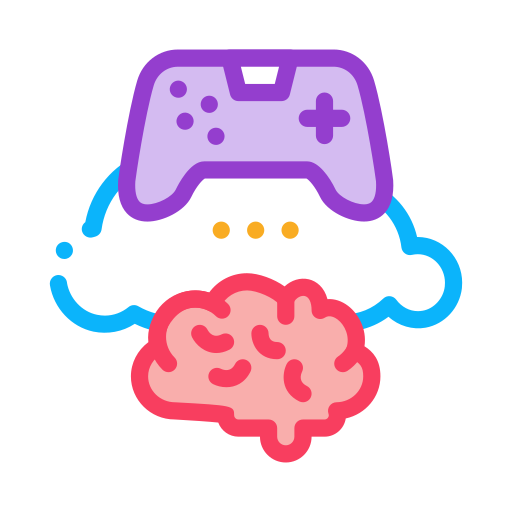

<div align="center">



# INTELLECT

**A web-based cognitive training platform with 30 mini-games**

[](https://react.dev/)
[](https://vite.dev/)
[](https://tailwindcss.com/)
[](https://vitest.dev/)
[](https://opensource.org/licenses/MIT)

</div>

INTELLECT helps you sharpen your mind through short, engaging games. It tracks your progress, builds your streaks and rewards you with badges across five cognitive domains.

## Demo

[](https://youtu.be/Zt3W2iLLf9E)

*Click the image to watch the demo on YouTube.*

## Features

- **30 mini-games** across five cognitive domains
- **Progress tracking** with scores, XP, streaks and badges
- **Skill bars and daily workouts** for regular training
- **Animated pixel-style interface** built with Tailwind CSS and Framer Motion
- **Custom sound effects** generated with the Web Audio API
- **Local accounts** for separate progress per user on the same browser

> **Note:** Accounts and progress are stored only in the browser's `localStorage`, and passwords are not hashed. This is suitable for a prototype, so do not use a real password.

## Cognitive domains

| Domain | Games |
| --- | --- |
| **Memory** | MemoryMatch, SequenceEcho, NumberFlash, PatternRecall, MissingItem, WordVault |
| **Attention** | FocusFinder, ColorClash, TargetTap, TwinHunt, HeadCount, StopOrGo |
| **Speed** | SpeedTap, NumberRush, QuickMath, ReactionBlitz, ArrowStorm, PixelWhack |
| **Flexibility** | RuleSwitch, OppositeArrows, ReverseRecall, OddEvenSwitch, WordFlip, BinFlip |
| **Problem solving** | NumberSequence, MissingOperator, WordScramble, ShapePattern, SumTarget, BalanceScale |

## Tech stack

| Area | Technology |
| --- | --- |
| Framework | [React 19](https://react.dev/), [React Router](https://reactrouter.com/) |
| Build tool | [Vite](https://vite.dev/) |
| Styling and animation | [Tailwind CSS](https://tailwindcss.com/), [Framer Motion](https://motion.dev/) |
| Testing | [Vitest](https://vitest.dev/), [React Testing Library](https://testing-library.com/) |
| Linting | [Oxlint](https://oxc.rs/docs/guide/usage/linter.html) |

## Getting started

You need [Node.js](https://nodejs.org/) 20.19 or newer.

```bash
git clone https://github.com/yigittozdemirr/intellect-brain-games.git
cd intellect-brain-games
npm install
npm run dev
```

Then open http://localhost:5173.

### Commands

| Command | Description |
| --- | --- |
| `npm run dev` | Start the development server |
| `npm run build` | Create a production build |
| `npm run preview` | Preview the production build |
| `npm test` | Run the tests |
| `npm run lint` | Run Oxlint |

## Project structure

```text
src/
├── components/   # Game shell and shared UI components
├── context/      # Authentication context
├── games/        # Games grouped by domain
├── lib/          # Progress, scoring, sound, auth and helpers
├── scene/        # Animated pixel scene for the welcome screen
├── screens/      # Welcome, login, register, home and games screens
├── tests/        # Unit tests
└── App.jsx       # Application root
```

## Contributing

To add a new game, see the [game guide](docs/ADDING_GAMES.md), which explains how to connect it to the game registry.

1. Fork the project.
2. Create a branch: `git checkout -b feature/my-feature`
3. Commit your changes: `git commit -m "feat: add my feature"`
4. Push the branch: `git push origin feature/my-feature`
5. Open a pull request.

## License

MIT
